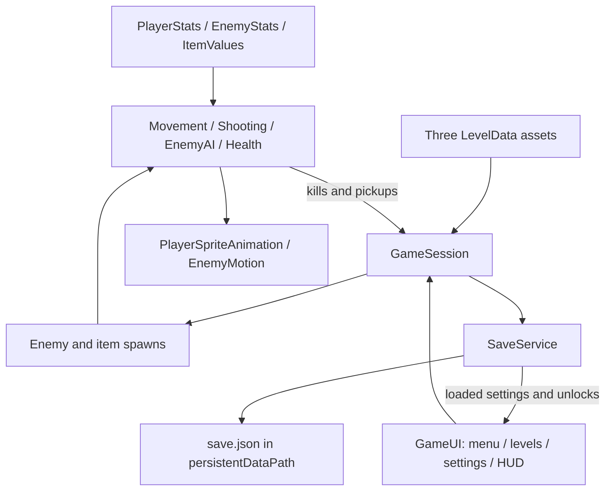

# Tuman — Assignment 11: Data and Saves

Open with Unity **6000.4.8f1**, then open `Assets/Scenes/Tuman11.unity` and press Play. The original `Courtyard.unity` and VillageSource tile art are retained.

## Play

- WASD/arrows or the left touch joystick: move.
- Space or hold the right FIRE control: shoot at the nearest living enemy. The player can move and shoot together. With no enemy nearby, the player fires in the movement/last aim direction.
- Clear all werewolves before the timer ends. Each has 3 HP; each normal shot does 1 damage. Walls block projectiles and enemy sight.
- Green herbs heal; gold tokens award score. Their values are data assets.
- Victory unlocks the next courtyard and saves progress. Failure saves the best score but does not unlock a level.
- Pause, resume, retry, level selection, audio settings and reset confirmation are available in the UI.

## Data assets

| Asset | What to change |
|---|---|
| `Assets/Data/PlayerStats.asset` | HP, movement, invulnerability, shot damage/range/cooldown/speed/radius and animation timing |
| `Assets/Data/Werewolf_1.asset` through `_3.asset` | Enemy HP/damage, patrol/chase, sight, attack and animation timing |
| `Assets/Data/ItemValues.asset` | Enemy/token scores, healing, completion reward, pickup distance |
| `Assets/Data/Level_01.asset` through `_03.asset` | Level name, objective, time, player/enemy/item spawns and enemy stats |
| `Assets/Data/PlayerAnimations.asset` | Directional sprite frame arrays |

Gameplay in Tuman11 reads these assets. Legacy serialized fields are retained only to keep the original Task 10 scene compatible. Numerical tolerances, color values, UI geometry and save-format validation are not game-balance parameters.

## Save

`save.json` is written under `Application.persistentDataPath`, using `JsonUtility`, not BinaryFormatter or PlayerPrefs.

Saved fields: format/version, completed-level count, best score, last selected level, unlocked-level array, ambience/effects volumes and vibration preference. Missing, malformed, unsupported-version or invalid saves fall back to defaults. Settings changes, level results, level entry, application pause and quit trigger saving. Writes use a temporary file, replacement where supported and a checked copy fallback. Storage errors are reported to the UI.

The reset action requires an explicit in-game confirmation, restores defaults and writes them to disk. Lock states come from the loaded save, not a hardcoded list in the UI.

## Script map

`GameSession` owns run state and progression; `GameUI` presents it; `SaveService` owns serialization and validation. `GameAudio` applies persisted sound settings. Player animation selects one of four states and four directions. Enemy animation follows patrol/chase/attack/death; chase plays the walk frames faster. Generated art is a working prototype and can be refined independently of gameplay.

## Verification

Editor-only `VerifyTask11.Run` tests missing/corrupt files, JSON round trips, reset persistence, locked-level denial, settings sliders, three data-driven spawn configurations, real projectile damage, animation arrays, a live speed change, unlocks, pause/resume and application-pause saving. It isolates filesystem corruption tests from user data and backs up/restores the real save around Play mode. Reports are copied into the submission folder.

These checks do **not** replace the required physical-phone force-stop/relaunch demonstration or the student's own English narration.

## Art and references

- Existing user-provided VillageSource tiles and player Idle/Walk sprites are retained.
- Player shooting and werewolf action sheets were generated with OpenAI image generation in this chat.
- Existing village menu illustration was generated earlier in this project.
- UI design reference: [Kenney UI Pack](https://kenney-assets.itch.io/ui-pack), freely available under [CC0](https://creativecommons.org/publicdomain/zero/1.0/). No Kenney sprites are included; the menus are constructed from Unity UI shapes, typography and the existing project background.
- Direct agent work is disclosed in `AI_LOG.txt` and `DECISIONS.md`.
